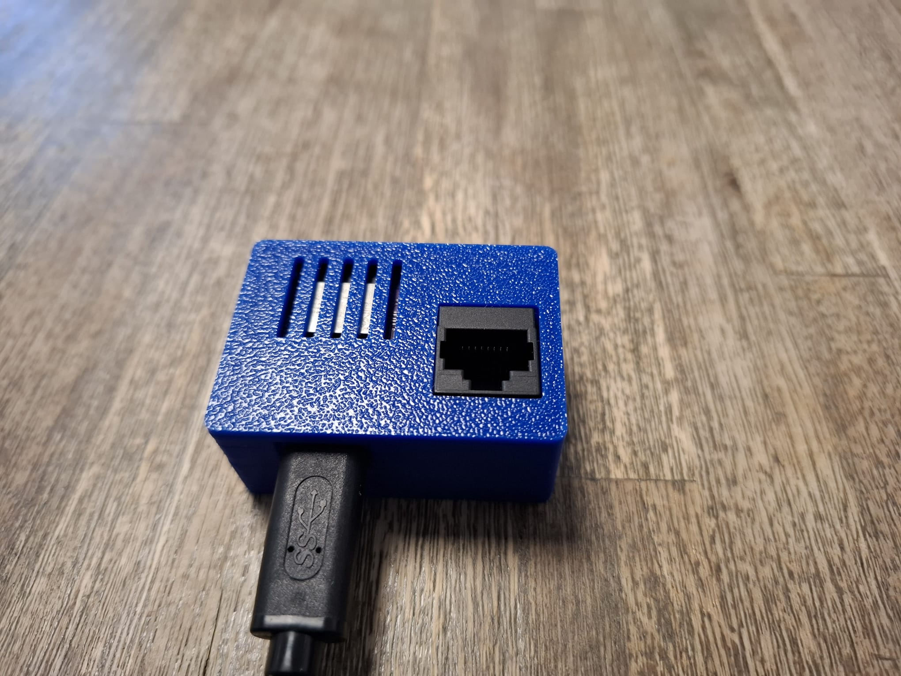
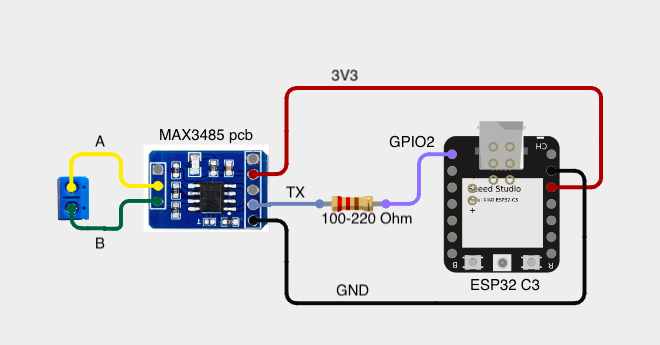

# Wifi adapter for JK BMS

JK BMS units hold a lot of data: individual cell voltages, temperatures, balancing state, cycle counts and capacity. Normally this is only available through the manufacturer's Bluetooth app or indirectly via an inverter display.

> Read data from a JK BMS over RS485 and publish it to your local network via WiFi.

## Features

- Reads cell voltages, pack voltage, current, SoC, temperatures and balancing status
- Publishes data over WiFi to Home Assistant (for example).
- Supports multiple BMS units (up to 16)
- Support reading of values (no data is sent over modbus - sniffing only)

## Build one?

## Buy one?

[Poll](https://github.com/ajvdw/wifi-jk-bms/issues/1)

## Supported hardware

| Component | Tested model | Notes |
|-----------|--------------|-------|
| BMS | JK-BMS (TODO: model, e.g. JK-PB2A16S20P) | Firmware v14, v15, v19 tested |
| Microcontroller | ESP32 / ESP8266)  |
| RS485 transceiver | TODO (e.g. MAX485 / auto-direction module) | 3.3 V compatible |

## Wiring

Provide power through USB-C
Connect an ethernet cable to one of the RS485 ports on the BMS

## Installation

Once connected the module presents itself as an Wifi Access point (password = jkbmspwd).
If the configuration screens not opens automaticallys, browse to http://192.168.4.1

## Configuration

Change the esphome yaml configuration to meet your requirements.
It is configured for 2 BMS-es out of the box.

## Usage

1. Wire the RS485 adapter to the BMS.
2. Open the Wifi network (BMSWIFI)
3. Configure your Wifi setting for local access
4. Open Homeassistant, the device should be discovered automatically
5. Configure you favourite battery card

### Example output

TODO

## Troubleshooting

- **No data received:** check your cables.
- **Garbled data:** verify baud rate (TODO) and ground connection.
- **Multiple BMS units clash:** make sure each has a unique address.

## Bill of materials

- JK BMS
- microcontroller ESP32C3 / ESP8266
- RS485 module (MAX3485 PCB)
- Power supply
- USB Cable

## Contributing

Issues and pull requests are welcome. If you have a JK BMS model or firmware version not listed above, please report whether it works.

## License

TODO (e.g. MIT)

## Acknowledgements

- TODO: reference projects, protocol documentation, contributors
